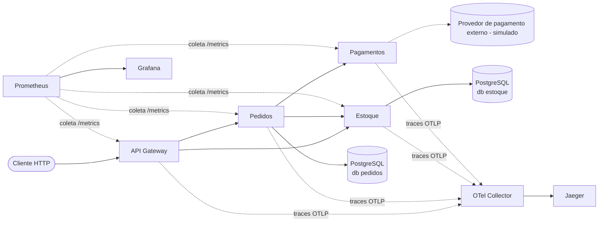

# 🛒 Pedidos Veloz: microsserviços do Docker Compose ao Kubernetes

[](https://github.com/BonAnni92/pedidos-veloz/actions/workflows/ci-cd.yml)

Projeto da disciplina **Cloud DevOps – Orchestrating Containers and Micro Services**.
O caso é a **Loja Veloz**, um e-commerce de médio porte com três problemas:

- indisponibilidade durante os deploys;
- dificuldade de escalar nos picos de acesso;
- pouca rastreabilidade de falhas entre serviços.

> 🎥 **Vídeo pitch:** _[COLE AQUI O LINK DO YOUTUBE]_
> 📄 **Relatórios:** [`docs/`](docs/) (Parte Teórica e Parte Prática)

---

## Arquitetura



| Serviço | Responsabilidade | Banco |
|---|---|---|
| **gateway** | Ponto único de entrada, roteamento, validação na borda, `X-Request-ID` | – |
| **pedidos** | Cria e consulta pedidos; orquestra Estoque e Pagamentos com compensação | `pedidos` |
| **estoque** | Catálogo, reserva (com `SELECT … FOR UPDATE`), baixa e cancelamento | `estoque` |
| **pagamentos** | Simula o gateway de pagamento externo (latência, recusa e falha configuráveis) | – |

**Fluxo de um pedido:**

1. O Pedidos consulta o preço no Estoque.
2. Grava o pedido como `PENDENTE`.
3. Reserva os itens no Estoque.
4. Cobra no Pagamentos.
5. Termina de um destes jeitos:
   - aprovado: confirma a reserva e o pedido fica `CONFIRMADO`;
   - recusado: cancela a reserva e o pedido fica `RECUSADO`;
   - provedor fora do ar: cancela a reserva e o pedido fica `FALHOU`.

**Stack:**

- Aplicação: Python 3.12, FastAPI e SQLAlchemy, com PostgreSQL 16.
- Infraestrutura: Docker / Compose, Kubernetes (Kustomize) e Terraform.
- CI/CD: GitHub Actions publicando no GHCR.
- Observabilidade: OpenTelemetry, Jaeger, Prometheus e Grafana.

---

## Estrutura do repositório

```
├── services/                 # um diretório por microsserviço (código, testes, Dockerfile)
│   ├── gateway/  pedidos/  estoque/  pagamentos/
├── libs/veloz_common/        # código transversal: logs JSON, métricas, tracing, health
├── docker-compose.yml        # ambiente local completo (1 comando)
├── observability/            # configs do OTel Collector, Prometheus e Grafana (local)
├── db/init.sql               # cria um banco por serviço
├── k8s/
│   ├── base/                 # Deployments, Services, ConfigMap, HPA, PDB, NetworkPolicy, PSA
│   ├── overlays/local/       # Rancher Desktop / kind (imagens :local + Secret de dev)
│   ├── overlays/prod/        # produção (tag imutável, Ingress com TLS, mais réplicas)
│   ├── observability/        # Collector, Jaeger e Prometheus no cluster
│   └── optional/vpa.yaml     # VPA em modo recomendação
├── terraform/                # IaC: VPC + EKS (módulo cluster) e namespace governado
├── .github/workflows/        # pipeline CI/CD
├── .devcontainer/            # ambiente pronto no GitHub Codespaces
└── scripts/                  # smoke test, gerador de carga, deploy local
```

---

## 1. Ambiente local com Docker Compose

**Pré-requisito:** Docker. Pode ser o **Rancher Desktop**, com o motor *dockerd (moby)*, ou o Docker Desktop.
Outra opção é o **GitHub Codespaces**: botão *Code → Codespaces → Create*, que já vem com tudo instalado.

```bash
docker compose up -d --build      # ⬅️ um único comando sobe os 9 contêineres
docker compose ps                 # todos devem ficar "healthy"/"running"
```

| O quê | Endereço |
|---|---|
| API (Swagger para testar no navegador) | http://localhost:8080/docs |
| Catálogo | http://localhost:8080/api/produtos |
| Jaeger (traces) | http://localhost:16686 |
| Grafana (dashboard "Pedidos Veloz") | http://localhost:3000 |
| Prometheus | http://localhost:9090 |

**Criar um pedido.** Pode ser pelo Swagger (`/docs` → `POST /api/pedidos` → *Try it out*) ou pelo terminal:

```bash
curl -X POST http://localhost:8080/api/pedidos \
  -H "content-type: application/json" \
  -d '{"sku": "TEN-001", "quantidade": 1, "metodo_pagamento": "pix"}'
```

Para ver cada desfecho:

- `"sku": "MOC-003", "quantidade": 99` → `RECUSADO` (estoque insuficiente)
- `"sku": "TEN-001", "quantidade": 20` → `RECUSADO` (valor acima do limite do pagamento)

**Outros comandos úteis:**

```bash
bash scripts/smoke-test.sh                                   # teste ponta a ponta
python3 scripts/load_test.py --duracao 60 --concorrencia 20  # carga (ver no Grafana)
docker compose logs -f pedidos                               # logs JSON com trace_id
docker compose down -v                                       # derruba e apaga os dados
```

**O que o Compose define:**

- **Redes:**
  - `frontend`: só o que é acessado do host;
  - `backend`: interna, `internal: true`, sem saída para a internet.
- **Volumes:** `pgdata` (dados do PostgreSQL) e `promdata`.
- **Variáveis de ambiente:** já têm valores padrão. Para alterar, copie `.env.example` para `.env`.
- **Ordem de subida:** `depends_on` com `condition: service_healthy`.
- **Limites:** CPU e memória por serviço.

---

## 2. Contêineres e versionamento

Cada `services/*/Dockerfile` segue estas práticas:

- **Multi-stage:**
  - o estágio `builder` instala as dependências em um virtualenv;
  - o `runtime` copia só o virtualenv e o código. Compilador e cache não vão para a imagem.
- **Imagem base enxuta:** `python:3.12-slim` e dependências com **versões fixas**.
- **Usuário não-root** com UID fixo `10001`. Isso é exigido pelo `runAsNonRoot` do Kubernetes.
- **Ordem de camadas pensada para cache:** o `requirements.txt` é copiado antes do código.
- **Labels OCI** com versão e commit.
- **Execução:** `HEALTHCHECK` e `CMD` em forma *exec*, para o SIGTERM chegar ao processo.
- **`.dockerignore`:** não envia testes, `.env` nem `.git` para o build.

**Versionamento das imagens**, feito pelo pipeline em `ghcr.io/bonanni92/pedidos-veloz-<serviço>`:

| Tag | Quando | Para quê |
|---|---|---|
| `sha-<commit>` | todo push | **imutável e rastreável**; é a tag usada no deploy e no rollback |
| `1.2.3` e `1.2` | tag git `v1.2.3` | releases semânticas |
| `latest` | push na `main` | conveniência (nunca usada em produção) |

---

## 3. Kubernetes

### Rodar no Rancher Desktop

1. Em *Preferences → Kubernetes*, marque **Enable Kubernetes**.
2. Em *Container Engine*, escolha **dockerd (moby)**.
3. Rode os comandos abaixo, no PowerShell ou no terminal:

```bash
docker compose build                             # gera as imagens :local
kubectl apply -k k8s/observability               # Collector, Jaeger, Prometheus
kubectl apply -k k8s/overlays/local              # aplicação
kubectl -n loja-veloz get pods -w                # aguarde todos "Running 1/1"
kubectl -n loja-veloz port-forward svc/gateway 8080:8000
```

Atalho em bash: `bash scripts/k8s-deploy.sh`.
No Codespaces, antes do deploy, crie o cluster com `bash scripts/kind-up.sh`.

### O que os manifests implementam

- **Deployment e Service por serviço.**
  - Services do tipo `ClusterIP`: só o gateway é exposto, via Ingress no overlay de produção.
- **ConfigMap e Secret.**
  - `veloz-config` guarda a configuração não sensível.
  - `veloz-db-credentials` guarda as credenciais.
  - No ambiente local, o Secret é gerado pelo Kustomize, com hash, o que reinicia os Pods quando a senha muda.
  - Em produção, ele é criado pelo pipeline a partir dos GitHub Secrets. **Nenhuma senha real fica no Git.**
- **Probes.**
  - `startupProbe` dá tempo para esperar o banco.
  - `readinessProbe` (`/health/ready`) só libera tráfego quando o banco responde.
  - `livenessProbe` (`/health/live`) não depende do banco, para evitar reinícios em cascata.
- **Segurança.**
  - Namespace com **Pod Security Admission `restricted`**: o API server recusa Pods inseguros.
  - Em todos os Pods:
    - `runAsNonRoot`;
    - `allowPrivilegeEscalation: false`;
    - `readOnlyRootFilesystem`;
    - `capabilities: drop [ALL]`;
    - `seccompProfile: RuntimeDefault`;
    - `automountServiceAccountToken: false`.
  - **NetworkPolicies** com *default deny* e liberação só dos fluxos da arquitetura.
- **Disponibilidade.**
  - `PodDisruptionBudget`.
  - `topologySpreadConstraints`: réplicas em nós diferentes.
  - `preStop` para o desligamento gracioso.
- **Recursos.** `requests` e `limits` em todos os contêineres. Eles também são a base do HPA.

---

## 4. Estratégia de deploy: Rolling Update

`maxSurge: 1` e `maxUnavailable: 0`, combinados com a readiness probe. O Kubernetes:

1. sobe 1 Pod novo;
2. espera esse Pod ficar *ready*;
3. só então remove 1 Pod antigo.

A capacidade nunca cai abaixo do normal, e por isso não há indisponibilidade.
Se o Pod novo não ficar pronto, o rollout para sozinho. O pipeline faz `rollout undo` automático.

**Demonstração (zero erro durante o deploy):**

```bash
python3 scripts/load_test.py --duracao 90 --concorrencia 10 &     # tráfego contínuo
kubectl -n loja-veloz set env deployment/pedidos LOG_LEVEL=DEBUG  # dispara um rolling update
kubectl -n loja-veloz rollout status deployment/pedidos
kubectl -n loja-veloz rollout undo deployment/pedidos             # rollback em segundos
```

**Por que Rolling e não Blue-Green ou Canary?**

- O Rolling é nativo e não exige infraestrutura duplicada, como o Blue-Green.
- Também não exige service mesh, como o Canary.
- Atende ao prazo de 4 semanas.

O **Canary com Istio** fica como evolução: 5% → 25% → 100%, com rollback por métrica de erro.

---

## 5. Escalabilidade: HPA (+ VPA em recomendação)

- **HPA** por CPU (70%) no `gateway` e no `pedidos` (2 a 10 réplicas) e no `estoque` (2 a 6).
  - Escala para cima rápido: até +4 Pods a cada 15 s.
  - Escala para baixo devagar: janela de 5 min, para evitar o "efeito sanfona".
  - Em produção, o mínimo sobe para 3.
- O **Pagamentos não tem HPA**, porque o gargalo dele é o limite do provedor externo, e não CPU.
- **VPA** (`k8s/optional/vpa.yaml`) roda em `updateMode: "Off"`, só recomendando valores.
  - Ele não deve agir junto com o HPA na mesma métrica.
  - Usamos as recomendações para ajustar os `requests`.
- **Ver o HPA em ação:**

  ```bash
  python3 scripts/load_test.py --duracao 180 --concorrencia 40
  kubectl -n loja-veloz get hpa -w
  ```

  É preciso o metrics-server. Ele já vem no Rancher Desktop; no kind, o `scripts/kind-up.sh` instala.

---

## 6. Observabilidade

| Sinal | Como | Onde ver |
|---|---|---|
| **Métricas** | `/metrics` em cada serviço (`prometheus-fastapi-instrumentator`): req/s, latência p95, erros 5xx, mais métricas de negócio (`pedidos_criados_total`, `pagamentos_total`) | Prometheus / Grafana |
| **Logs** | JSON no stdout (12-Factor), com `service`, `trace_id` e `span_id` | `docker compose logs` / `kubectl logs` |
| **Traces** | OpenTelemetry com auto-instrumentação de FastAPI, httpx e SQLAlchemy, contexto W3C `traceparent` entre serviços → OTel Collector → Jaeger | Jaeger |

O `trace_id` aparece no log e no trace. Assim, de um erro no log se chega ao trace completo da requisição.

**Para provocar falhas e ver no Jaeger:**

```bash
PAGAMENTO_TAXA_FALHA=0.3 docker compose up -d pagamentos
```

Com isso, 30% dos pagamentos falham. No Jaeger, procure por `service=pedidos` e `error=true`.

Em Kubernetes, o Collector faz **amostragem de 20%** para controlar o custo.
Um **service mesh (Istio)** acrescentaria mTLS e telemetria sem mudar código. Ele foi deixado como evolução, pelo custo operacional dos sidecars.

---

## 7. CI/CD (GitHub Actions)

Arquivo: [`.github/workflows/ci-cd.yml`](.github/workflows/ci-cd.yml)

```
PR / push main ─► lint + testes (por serviço) ─┬─► teste E2E com Docker Compose
                  validação de infra ──────────┴─► build ─► scan Trivy ─► push GHCR
tag v*.*.*     ─► tudo acima ─► [aprovação manual] ─► deploy em produção ─► rollout status / undo
```

- **Testes:**
  - `ruff` faz o lint;
  - `pytest` roda com cobertura, e os relatórios JUnit ficam como *artifacts*;
  - o smoke test roda contra o Compose.
- **Validações de infra:**
  - `hadolint` nos Dockerfiles;
  - `docker compose config`;
  - `kubeconform` nos manifests;
  - `terraform fmt` e `terraform validate`.
- **Segurança:** o Trivy reprova a imagem se houver vulnerabilidade **CRITICAL** com correção disponível.
- **Secrets:**
  - `GITHUB_TOKEN`, automático, publica no GHCR;
  - `KUBE_CONFIG`, `DB_USER` e `DB_PASSWORD` ficam no *environment* `production`;
  - nada fica no código.
- **Cache:** de pip (`setup-python`) e de camadas Docker (`type=gha`).

**Para ativar o deploy em um cluster real:**

1. Em *Settings → Environments*, crie o ambiente `production` e marque *Required reviewers*.
2. Adicione os secrets `KUBE_CONFIG` (kubeconfig em base64), `DB_USER` e `DB_PASSWORD`.
3. Crie uma release com `git tag v0.1.0 && git push --tags`.

---

## 8. Infraestrutura como código (Terraform)

Pasta [`terraform/`](terraform/), um **esqueleto validado** (`terraform validate`):

- `modules/cluster`: VPC em várias AZs (subnets privadas para os nós) e **Amazon EKS** com node group gerenciado e add-ons. Usa os módulos `terraform-aws-modules` com versões fixas.
- `modules/app-namespace`: namespace com PSA `restricted`, **ResourceQuota** e **LimitRange**.
- `envs/dev` e `envs/prod`: o **mesmo código**, com valores diferentes em `terraform.tfvars`:
  - dev: 2 AZs e 1 NAT;
  - prod: 3 AZs, 1 NAT por AZ e mais nós.
- **State remoto** em S3, com lock (`backend.hcl.example`).

```bash
cd terraform/envs/dev
cp backend.hcl.example backend.hcl        # ajuste o bucket
terraform init -backend-config=backend.hcl
terraform plan
```

---

## 9. Princípios 12-Factor aplicados

| Fator | Onde |
|---|---|
| III. Config | variáveis de ambiente, ConfigMap e Secret; a mesma imagem serve a todos os ambientes |
| IV. Serviços de apoio | PostgreSQL e Collector acessados por URL configurável |
| VI. Processos | serviços stateless; o estado fica só no PostgreSQL |
| VII. Port binding | cada serviço expõe HTTP na porta 8000 |
| IX. Descartabilidade | inicialização rápida, SIGTERM tratado, `preStop` e `terminationGracePeriodSeconds` |
| X. Paridade dev/prod | as mesmas imagens no Compose e no Kubernetes |
| XI. Logs | fluxo JSON no stdout |

## Referência

Inspirado no [Online Boutique (Google)](https://github.com/GoogleCloudPlatform/microservices-demo) e no [OpenTelemetry Demo](https://github.com/open-telemetry/opentelemetry-demo).
